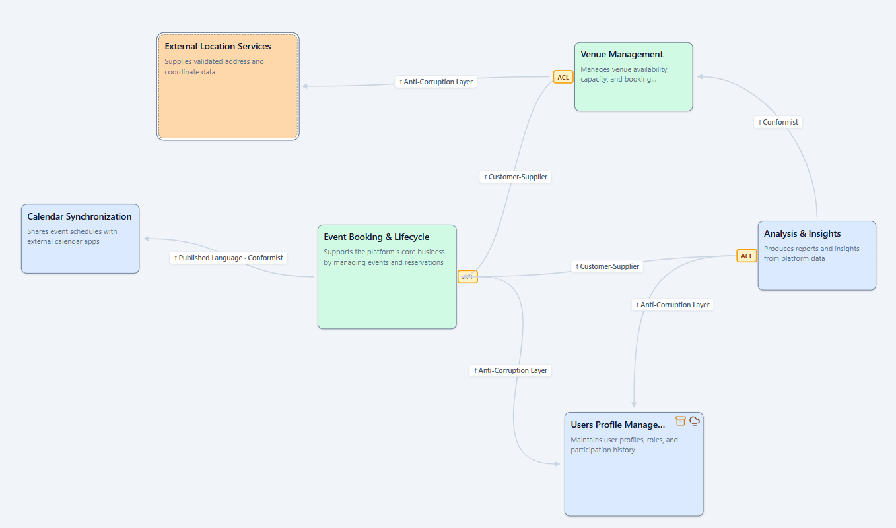

# Part 2 - Context Mapping: Event Horizon

[Workshop instructions and submission checklist](../readme.md)

**Digital tool:** [Context Flow](https://contextflow.virtualgenius.com/) for creating your context map.

## Overview

Your team has been hired to design the architecture for a new platform called **Event Horizon**. The platform allows users to organize or join events that take place during a specific time period at a physical location.

Initial business workshops identified six capabilities. Use these as the starting bounded contexts for this exercise:

| Capability | Responsibility |
| --- | --- |
| Event Booking & Lifecycle | Creates events, matches times, tracks seat availability, and handles ticket reservations. |
| Users Profile Management | Manages organizers and customers, including their profiles, roles, and histories. |
| Venue Management | Manages physical spaces, room capacities, operating hours, and booking rules. |
| External Location Services | Provides access to the external Google Maps API for precise coordinates and address checks. |
| Calendar Synchronization | Formats and sends schedule dates to users' external calendar apps, such as Apple Calendar or Google Calendar. |
| Analysis & Insights | Collects data across the platform to generate business reports, demand trends, and usage metrics. |

## Architectural and business realities

Use these interview notes as evidence for your modeling decisions:

1. **Business differentiation.** Leadership says the platform's market advantage comes from how smoothly it handles real-time ticket reservations, booking rules, and event matching. This is where the highest budget is being spent.

2. **Legacy profiles.** Users Profile Management is an inherited internal application. Its developers describe it as a "Big Ball of Mud" with messy, outdated code. The Event Booking team wants to protect its new domain model from that database structure, so profile database changes do not force changes to the core booking logic.

3. **Physical constraints.** Event Booking cannot finalize an event without validating it against capacity rules and maintenance slots controlled by Venue Management. The Booking team relies on the Venue team for this operational logic, and the two teams must collaborate closely as business partners. The Venue team includes the Booking team’s requirements and priorities in its development planning.

4. **Mapping provider.** Venue Management needs coordinates from External Location Services, which uses Google Maps. The venue developers want to keep vendor-specific API structures out of their internal domain logic. Switching to a different provider, such as OpenStreetMap, should leave that logic unaffected.

5. **Calendar standard.** Calendar Synchronization uses the publicly documented iCalendar (.ics) format to send dates to external calendars. The Event Booking developers have decided to structure their calendar-bound payloads to match that format directly, without custom translation layers.

6. **Analytics.** Analysis & Insights has no authority over operational systems. It consumes data from Venue Management, Event Booking, and Users Profile Management to build its metrics database. Because profile data is inconsistent, the analysis developers must clean and transform it on arrival to keep reports working correctly. The Event Booking team includes the Analysis & Insights team’s data requirements and priorities in its development planning.

### Question 3: Domain classification

Classify the business capability represented by each context as **Core**, **Supporting**, or **Generic**. Justify each classification using the platform's business priorities and the scenario notes.

**Answer:**

| Context | Classification | Justification |
| --- | --- | --- |
| Event Booking & Lifecycle | Core | Dit is het belangrijkste onderdeel van het platform. Real-time reserveringen en event matching vormen het concurrentievoordeel. |
| Users Profile Management | Generic | Profielen, gebruikersrollen en gebruikersinformatie zijn standaardfunctionaliteiten. |
| Venue Management | Supporting | Nodig om locaties, capaciteiten en beschikbaarheid te beheren en boekingen te valideren. |
| External Location Services | Generic | Gebruikt bestaande diensten zoals Google Maps. |
| Calendar Synchronization | Generic | Gebruikt het bestaande iCalendar-formaat (.ics) |
| Analysis & Insights | Supporting | Verwerkt platformspecifieke gegevens om rapportages en analyses te maken, maar is geen primair concurrentievoordeel. |

### Question 4: Relationships and integration patterns

Complete the table for all interacting context pairs in the scenario. Add one row per relationship and identify:

- The upstream context.
- The downstream context.
- The integration pattern(s) and which context uses each pattern.

**Answer:**

| Context 1 | Upstream / Downstream | Pattern(s) for Context 1 | Pattern(s) for Context 2 | Context 2 | Upstream / Downstream |
| :--- | :--- | :--- | :--- | :--- | :--- |
| Users Profile Management | Upstream | — | Anti-Corruption Layer (ACL) | Event Booking & Lifecycle | Downstream |
| Venue Management | Upstream | Customer/Supplier (Supplier) | Customer/Supplier (Customer) | Event Booking & Lifecycle | Downstream |
| External Location Services | Upstream | — (External API) | Anti-Corruption Layer (ACL) | Venue Management | Downstream |
| Calendar Synchronization | Upstream (integration contract) | Published Language (.ics) | Conformist | Event Booking & Lifecycle | Downstream |
| Event Booking & Lifecycle | Upstream | Customer/Supplier (Supplier) | Customer/Supplier (Customer) | Analysis & Insights | Downstream |
| Venue Management | Upstream | — | Conformist | Analysis & Insights | Downstream |
| Users Profile Management | Upstream | — | Anti-Corruption Layer (ACL) | Analysis & Insights | Downstream |

### Question 5: Context map and review

#### 1. Context map

Create a context map that brings together your answers to Questions 3 and 4. 

**Screenshot Diagram:** 

**Link to json:** [event-horizon.project.json](../event-horizon.project.json)

#### 2. Review and reflection

Review the context map, do you see any potential problems with the relationships or patterns? If so, what are they and how would you fix them?

--------------------------------------------

1. Users Profile Management:
Het is een Legacysysteem dat beschreven wordt als een big ball of mud. Door de rommelige structuur kunnen wijzigingen aan dit systeem problemen veroorzaken bij andere contexten. Daarom gebruiken zowel Event Booking & Lifecycle als Analysis & Insights een Anti-Corruption Layer (ACL). Deze vertaallaag zorgt ervoor dat beide contexten onafhankelijk blijven van de interne structuur van het oude systeem.

2. Event Booking & Lifecycle en Venue Management:
Event booking kan een evenement niet definitief vastleggen zonder eerst capaciteit en beschikbaarheid van de locatie te controleren. Als Venue Management tijdelijk niet beschikbaar is, kan het allemaal verstoord worden. Hiervoor moeten er dus duidelijke communicatieafspraken en error handling zijn. Hierdoor is Customer/Supplier een goed patroon om te gebruiken.

3. Calender Synchronization:
Het bestaande .ics formaat gebruiken kan een risico vormen als er wijzigingen in dit formaat plaatsvinden.
Daarom moeten kalendergerelateerde gegevens zo veel mogelijk gescheiden blijven van de interne boekingslogica.

4. Analysis & Insights:
De gegevens die Analysis & Insights verzamelt, komen uit verschillende contexten. Omdat deze gegevens niet altijd consistent zijn, vooral bij Users Profile Management, moeten ze eerst opgeschoond en omgezet worden. Dit voorkomt fouten in de rapportages. Bovendien mag Analysis & Insights de operationele systemen niet rechtstreeks beïnvloeden.

Het belangrijkste is dat de afhankelijkheid van het legacy Users Profile Management systeem goed wordt beheerd of gefixt, zodat het geen negatieve impact heeft op de andere contexten. Tussen Event Booking & Lifecycle en Venue Management moet er duidelijk en goed samengewerkt worden zodat alles soepel verloopt. Voor Analysis & Insights is het belangrijk dat de gegevens die het ontvangt consistent en betrouwbaar zijn, zodat de rapportages correct zijn.