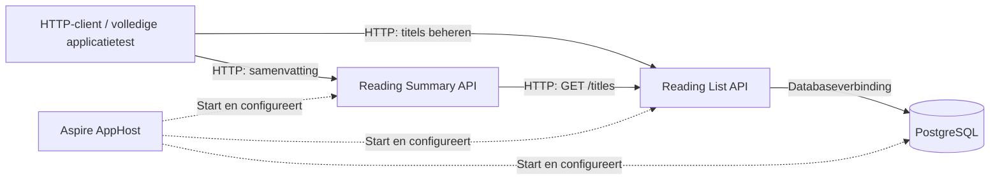

# Software Design - Groep 6

**Topic: .NET Aspire & Integration Testing**

**Deadline: 30/10/2026 om 23:59**

Deze repository bevat het groepsproject voor de module Software Design. We onderzoeken hoe je een kleine toepassing met meerdere processen opstart met .NET Aspire en test met echte afhankelijkheden. Het doel is het onderwerp begrijpen en kunnen uitleggen, niet een uitgebreide applicatie bouwen.

## Systeem en afbakening

De implementatie bevat twee afzonderlijke HTTP-API's en PostgreSQL. Een browserinterface is niet vereist.

| Resource | Verantwoordelijkheid |
| --- | --- |
| Reading List API | Titels en hun leesstatus opslaan in PostgreSQL |
| Reading Summary API | Reading List via HTTP aanroepen en het aantal ongelezen en afgewerkte titels teruggeven |
| PostgreSQL | Gegevens van de Reading List API bewaren |
| Aspire AppHost | De API-projecten, PostgreSQL en hun referenties beschrijven en starten voor ontwikkeling en volledige applicatietests |



De Summary API gebruikt uitsluitend het publieke HTTP-contract van Reading List en heeft geen toegang tot de database. De AppHost bevat geen businesslogica.

### Minimale workflow

1. Maak via Reading List een titel aan met status `Unread`.
2. Vraag via Summary de samenvatting op: de titel telt als ongelezen.
3. Markeer de titel via Reading List als `Finished`.
4. Vraag de samenvatting opnieuw op: de titel telt nu als afgewerkt.

## Basisbegrippen

| Begrip | Betekenis in dit project |
| --- | --- |
| Proces | Eén draaiend programma; de API's draaien in afzonderlijke processen |
| Service | Een onderdeel dat een verantwoordelijkheid aanbiedt, zoals de Summary API |
| Host | De machine of netwerknaam waarop een resource bereikbaar is |
| Poort | Het nummer waarmee netwerkverkeer bij de juiste luisterende toepassing terechtkomt |
| Endpoint | Een bereikbaar adres met onder andere host en poort; een HTTP-operatie gebruikt daarnaast een pad zoals `/titles` |
| Dependency | Een afhankelijkheid die een onderdeel nodig heeft, zoals PostgreSQL of een andere API |
| Service discovery | Een service via een logische naam vinden, terwijl configuratie het werkelijke adres levert |
| Gedistribueerde applicatie | Meerdere processen of resources die via een netwerk samenwerken; dit hoeft geen groot cloudsysteem te zijn |
| Container | Een geïsoleerde omgeving om software met de nodige runtime en configuratie uit te voeren |

Summary kan geen C#-methode in het Reading List-proces aanroepen en moet een HTTP-verzoek versturen. Ook als beide projecten compileren, kunnen adresconfiguratie, bereikbaarheid, time-outs en HTTP-responses problemen veroorzaken.

Docker is de container-runtime voor dit topic. Een PostgreSQL-container biedt dezelfde databaseversie op ontwikkelmachines en in CI zonder handmatige PostgreSQL-installatie. Containers lossen configuratie, schema-initialisatie, netwerkfouten en testisolatie niet automatisch op.

## Implementatiestatus

### 1. Reading List API

Een titel bevat minimaal een identifier, een niet-lege titel en de status `Unread` of `Finished`.
Code: [Program.cs](src/ReadingList.Api/Program.cs), [TitleItem.cs](src/ReadingList.Api/Models/TitleItem.cs) en [ReadingListDbContext.cs](src/ReadingList.Api/Data/ReadingListDbContext.cs). `TitleItem.Create` valideert en trimt de titel; `Finish` bewaakt de statusovergang. In het JSON-contract betekent `IsRead == false` de status `Unread` en `IsRead == true` de status `Finished`.

### 2. Reading Summary API

Code: [Program.cs](src/ReadingSummary.Api/Program.cs), [SummaryEndpoint.cs](src/ReadingSummary.Api/Endpoints/SummaryEndpoint.cs) en [ReadingSummaryCalculator.cs](src/ReadingSummary.Api/Services/ReadingSummaryCalculator.cs).

`Program.cs` configureert de benoemde HTTP-client en delegeert de aanvraag aan `SummaryEndpoint.HandleAsync`. Die methode haalt titels via HTTP op, geeft de cancellation token van de aanvraag door en laat de calculator de aantallen bepalen. Een JSON-antwoord `null` of ongeldige JSON levert `502 Bad Gateway` op. Een `HttpRequestException`, bijvoorbeeld door een netwerkfout of niet-succesvolle upstreamstatus, wordt vertaald naar `503 Service Unavailable`. De ongeldige-JSON-afhandeling heeft een gerichte unit test.

Summary valideert de upstreamdata voordat de aantallen worden berekend. In [TitleItem.cs](src/ReadingSummary.Api/Models/TitleItem.cs) maakt `JsonRequired` de velden `id`, `title` en `isRead` verplicht, zodat bijvoorbeeld een ontbrekende leesstatus niet stilzwijgend `false` wordt. Ontbrekende of onbruikbare velden, `null`-elementen, lege identifiers en lege of witruimtetitels leveren `502 Bad Gateway` op. Summary weigert dan de volledige response. Een lege lijst blijft geldig en geeft nul voor beide aantallen terug.

Responsecontract:

```json
{ "unread": 1, "finished": 0 }
```

De benoemde HTTP-client gebruikt nu de standaard resilience-handler met een totale pipeline-time-out van vijf seconden en een pogingstime-out van twee seconden. `HttpClient.Timeout` staat in de applicatie op oneindig, zodat de pipeline de time-outs beheert. De gedeelde configuratie staat in [ReadingListResilience.cs](src/ReadingSummary.Api/Services/ReadingListResilience.cs). `TimeoutRejectedException` van deze pipeline wordt eveneens naar `504 Gateway Timeout` vertaald. `SummaryEndpoint` vertaalt een `OperationCanceledException` naar `504 Gateway Timeout` wanneer de oorspronkelijke aanvraagtoken niet geannuleerd is. Annulering door de oorspronkelijke client wordt doorgegeven. De gerichte time-outtest gebruikt een kortere HTTP-clientlimiet van 100 milliseconden en een handler die met de doorgegeven token wacht; de test controleert `504` en dat de oorspronkelijke vijfsecondentoken niet geannuleerd is. Deze test controleert de foutvertaling, niet de vijfsecondenconfiguratie uit `Program.cs`. De geslaagde test `HandleAsync_WhenCallerCancels_PropagatesCancellation` gebruikt een vooraf geannuleerde aanvraagtoken en een HTTP-client zonder eigen time-out. Hij controleert dat een `OperationCanceledException` (of afgeleide exception) wordt doorgegeven in plaats van een `504`-antwoord. Annulering tijdens een al lopende aanvraag wordt hiermee niet afzonderlijk getest.

### 3. Aspire AppHost

Code: [AppHost.cs](src/ReadingList.AppHost/AppHost.cs).

Configuratie per reference:

| Consumer | Reference | Geleverde configuratie |
| --- | --- | --- |
| Reading List API | Benoemde PostgreSQL-database | Databaseverbindingsconfiguratie voor Reading List |
| Reading Summary API | Reading List API | Endpointconfiguratie waarmee service discovery het HTTP-adres kan bepalen |

Een reference levert configuratie en is meer dan een opstartvolgorde.

De AppHost is een lokaal compositieprogramma voor ontwikkeling en testen. Het vervangt de API's niet en bevat geen businesslogica. Het vervangt evenmin het ontwerpen van een productie-deployment.

### 4. Resilience en observability

De benoemde Reading List-client gebruikt `AddStandardResilienceHandler` met maximaal een retry (dus maximaal twee pogingen), een basisvertraging van 200 milliseconden en jitter. Retries zijn uitgeschakeld voor onveilige HTTP-methodes; de Summary-aanvraag gebruikt `GET`. De standaardhandler behandelt onder andere netwerkfouten en tijdelijke HTTP-foutstatussen en bevat ook een circuit breaker. De gedeelde configuratie wordt door de applicatie en de retry-test gebruikt.

De geslaagde test `Get_WhenFirstAttemptFails_RetriesAndSucceeds` in [ReadingListResilienceTests.cs](tests/ReadingList.UnitTests/ReadingListResilienceTests.cs) bouwt een echte resilience-pipeline via `IHttpClientFactory`, met een nagebootste upstream-handler. De eerste response is `503`, de tweede `200` met een lege JSON-lijst. De assertions controleren de succesvolle response, de inhoud en precies twee aanvragen. Er is geen echt netwerkverkeer. Dit bewijst herstel na een tijdelijke fout. Blijft de afhankelijkheid onbeschikbaar, dan kan een retry haar niet herstellen: na het ingestelde aantal pogingen of de tijdslimiet moet de aanvraag falen. Retries garanderen dus geen geslaagde gedistribueerde aanvraag.

Beide API's registreren healthcheck-services en hebben een apart liveness-endpoint op `/health/live`. `HealthCheckOptions.Predicate = _ => false` sluit afhankelijkheidschecks voor dit endpoint uit. Het endpoint controleert alleen of het API-proces HTTP-aanvragen kan verwerken en geeft dan `200 OK` met `Healthy` terug. Beide liveness-endpoints zijn via de draaiende applicatie gecontroleerd. Een onbereikbare afhankelijkheid hoort readiness te laten falen, niet liveness.

Reading List heeft een expliciet readiness-endpoint op `/health/ready`. [ReadingListReadinessCheck.cs](src/ReadingList.Api/Health/ReadingListReadinessCheck.cs) voert via de normale DbContext `AnyAsync` op de titeltabel uit. Een lege tabel is gezond; een mislukte query maakt de check ongezond. De check heeft de tag `ready` en een timeout van vijf seconden; het endpoint selecteert checks met die tag. De AppHost gebruikt nu `.WithHttpHealthCheck("/health/ready")` voor Reading List, zodat ook de bestaande tests op deze databasecontrole wachten. De wijziging is succesvol gecontroleerd. Het bestaande `/health` blijft beschikbaar.

Summary heeft eveneens een expliciet readiness-endpoint op `/health/ready`. [SummaryReadinessCheck.cs](src/ReadingSummary.Api/Health/SummaryReadinessCheck.cs) gebruikt de benoemde `reading-list`-client en `SummaryEndpoint.HandleAsync` om titels via HTTP op te halen en de samenvatting te berekenen. Alleen een succesvol resultaat met status `200` maakt de check gezond. Een foutresultaat maakt de check ongezond. De check gebruikt de tag `ready` en een timeout van tien seconden, naast de time-outs van de resilience-pipeline. De AppHost controleert nu ook Summary via `/health/ready`.

Summary-readiness hangt bewust van Reading List af: zonder bruikbare titels kan Summary haar basiswerk niet uitvoeren. Summary heeft geen rechtstreekse databaseverbinding nodig; die afhankelijkheid loopt via het publieke HTTP-contract. Liveness doet geen dependency-check en blijft daarvan onafhankelijk. De liveness- en readiness-endpoints geven in de werkende omgeving `Healthy` terug en de bestaande tests slagen met deze configuratie.

`HandleAsync_WhenUpstreamStaysUnavailable_Returns503` gebruikt dezelfde resilience-configuratie met een handler die altijd `503` teruggeeft. De test controleert precies twee aanvragen en een `ProblemHttpResult` met status `503`. Hiermee wordt aangetoond dat retries begrensd zijn en dat Summary blijvende upstreamfouten als onbeschikbaarheid rapporteert.

Beide API's roepen `ConfigureOpenTelemetry` aan uit [Extensions.cs](src/ReadingList.ServiceDefaults/Extensions.cs). Dit gedeelde ServiceDefaults-project configureert gestructureerde logs, inkomende ASP.NET Core-traces en uitgaande HttpClient-traces. De bestaande Aspire-Npgsql-integratie voegt de database-spans toe. De OTLP-exporter gebruikt het door Aspire aangeleverde `OTEL_EXPORTER_OTLP_ENDPOINT` en de bijbehorende authenticatieconfiguratie; er staat geen vast dashboardadres in de code. In Development worden alle traces verzameld. Zie ook het [officiële ServiceDefaults-patroon](https://aspire.dev/get-started/csharp-service-defaults/).

Een verzoek onderzoeken in het dashboard:

1. Controleer bij **Resources** de readiness van beide API's en PostgreSQL. Liveness toont of het proces reageert; readiness controleert ook de nodige afhankelijkheden.
2. Verstuur `GET /summary` naar het runtime-adres uit het dashboard en open de bijbehorende trace bij **Traces**.
3. Volg de vier spans: Summary ontvangt `/summary`, HttpClient verstuurt `GET /titles`, Reading List ontvangt `/titles` en Npgsql voert de PostgreSQL-query uit. De database-span beschrijft de query vanuit Reading List; de externe client zelf is niet geïnstrumenteerd.
4. Bekijk de gekoppelde **Structured logs** met dezelfde trace-ID. Reading List logt het aantal opgehaalde titels; Summary logt de resultaatstatus en gebruikt een waarschuwing bij een foutrespons. Traces tonen de volgorde, duur en foutstatus per stap; logs geven details over het resultaat. Consolelogs helpen ook bij opstartproblemen voordat telemetry beschikbaar is.

Deze keten en de gekoppelde logs van beide API's zijn via de Aspire CLI uit de dashboarddata gecontroleerd. De workflow gaf eerst `{ "unread": 1, "finished": 0 }` en na het afwerken `{ "unread": 0, "finished": 1 }`. De API-adressen kwamen uit de draaiende AppHost. Healthchecks veroorzaken ook traces; kies voor de demonstratie expliciet een trace van `/summary`. Telemetry helpt verklaren waar een fout optreedt, maar vervangt de testassertions niet.

Een aanvullende test die de time-outs van de echte resilience-pipeline uitput, valt buiten de gekozen projectscope. De bestaande time-outtest controleert de vertaling naar `504 Gateway Timeout`, niet het afdwingen van de ingestelde pipeline-time-outs.

## Postman: volledige applicatie

Importeer [postman_collection.json](postman_collection.json) uit de hoofdmap in Postman. Deze ene collectie vervangt de twee afzonderlijke collecties en de verouderde `.http`-voorbeelden.

1. Start Docker Desktop. Stel voor het lokale HTTP-profiel in PowerShell `$env:ASPIRE_ALLOW_UNSECURED_TRANSPORT = "true"` in en voer `dotnet run --project src/ReadingList.AppHost --launch-profile http` uit.
2. Open in Postman de variabelen van **Reading App - Complete API**. Stel `readingListBaseUrl` en `readingSummaryBaseUrl` in op de adressen van de twee API-resources in het Aspire-dashboard, zonder afsluitende `/`. De standaardwaarden zijn `http://localhost:5095` en `http://localhost:5066`, overeenkomstig de HTTP-launchprofielen. Gebruik de HTTPS-adressen als HTTP naar HTTPS doorstuurt. Een aparte Postman-environment is niet nodig.
3. Voer de hele collectie uit met de Collection Runner, of verstuur de requests handmatig. Voer binnen een workflow de requests in de aangegeven volgorde uit.

De collectie bevat vier mappen:

| Map | Inhoud |
| --- | --- |
| Health | Liveness en readiness van beide API's, plus `/health` van Reading List |
| Reading workflow | Basissamenvatting, titel aanmaken, lijst controleren, samenvatting controleren, afwerken en opnieuw controleren |
| Validation and errors | Lege titel, titel met alleen spaties, onbekende identifier en herhaald afwerken, met eigen setup |
| OpenAPI (Development) | De OpenAPI-documenten van beide API's; alleen beschikbaar in Development |

`titleText` bepaalt de titeltekst. Het aanmaakrequest bewaart automatisch `titleId` voor de volgende requests. Voor een bestaande titel kun je deze variabele zelf instellen. De negatieve workflow gebruikt apart `negativeTitleId`.

De samenvattingschecks vergelijken met de aantallen aan het begin van de workflow; een lege database is niet nodig. Vermijd gelijktijdige wijzigingen tijdens deze checks. Elke volledige run maakt twee titels aan en laat ze afgewerkt achter. De API biedt geen verwijderendpoint. De healthchecks verwachten gezonde afhankelijkheden; bij onbeschikbaarheid kan readiness `503 Unhealthy` teruggeven. Starten en stoppen van services en databasebeheer verlopen via Aspire/Docker.

## Geautomatiseerde tests

Een unit test controleert een klein stuk code zonder echte infrastructuur. Een integratietest controleert samenwerking met minstens één echte component. Een volledige applicatietest start de toepassing en gebruikt alleen haar publieke grens. Bewijs niet elk risico met de traagste test.

De huidige testsuite bevat 29 unit-testgevallen, een PostgreSQL-integratietest en twee Aspire-applicatietests: 32 testgevallen in totaal. Na het samenbrengen van de wijzigingen zijn alle tests opnieuw uitgevoerd en geslaagd volgens de bevestigde resultaten van de demovoorbereiding. De PostgreSQL-test controleert migraties en persistentie. De Aspire-tests controleren de volledige HTTP-workflow en het weigeren van een ongeldige titel met `400 Bad Request`. De endpoint-unit-tests controleren upstreamvalidatie, samenvattingen, time-outs en clientannulering.

De infrastructuurtests gebruiken cancellation tokens, dynamische adressen, eigen resources en automatische opruiming. Ze wachten op PostgreSQL-readiness of Aspire-healthinformatie en gebruiken geen `Thread.Sleep`. De JSON- en upstreamvalidatietests gebruiken nagebootste HTTP-handlers zonder echt netwerkverkeer.

| Testscope | Echte componenten | Minimaal te bewijzen |
| --- | --- | --- |
| Unit tests | Geen infrastructuur | Titelvalidatie, statusovergang, samenvattingsberekening, upstreamvalidatie en JSON-foutafhandeling |
| Testcontainers-integratietest | PostgreSQL en de normale database-driver of EF Core-context | Opslaan, teruglezen en de afgewerkte status blijvend opslaan |
| Aspire-applicatietest | Beide API-processen, HTTP en PostgreSQL | De volledige publieke workflow over beide API's en de database |

### A. Unit tests

Code: [TitleItemTests.cs](tests/ReadingList.UnitTests/TitleItemTests.cs), [ReadingSummaryCalculatorTests.cs](tests/ReadingList.UnitTests/ReadingSummaryCalculatorTests.cs) en [SummaryEndpointTests.cs](tests/ReadingList.UnitTests/SummaryEndpointTests.cs).

De tests controleren ongeldige titels, het trimmen van een geldige titel, een niet-lege identifier, de beginstatus `Unread`, de overgang naar `Finished` en het weigeren van opnieuw afwerken. Ze gebruiken geen Docker, Aspire, PostgreSQL of HTTP-server. Het PUT-endpoint roept `TitleItem.Finish()` aan en vertaalt opnieuw afwerken naar `400 Bad Request`.

De Summary API gebruikt [ReadingSummaryCalculator.cs](src/ReadingSummary.Api/Services/ReadingSummaryCalculator.cs) om de aantallen te berekenen. Vier aanvullende unit tests controleren een lege lijst, alleen ongelezen titels, alleen afgewerkte titels en een gemengde lijst. De calculator gebruikt het eigen titelmodel van Summary; de HTTP-aanroep blijft in het endpoint.

`SummaryEndpoint.HandleAsync` is losgemaakt van de routeconfiguratie zodat de foutafhandeling rechtstreeks getest kan worden. `HandleAsync_WithInvalidJson_ReturnsBadGateway` gebruikt een eigen `HttpMessageHandler` die `200 OK` met ongeldige JSON teruggeeft. De test controleert dat het resultaat een `ProblemHttpResult` met status `502` en titel `Bad Gateway` is. Het basisadres `http://reading-list.test` leidt niet tot echt netwerkverkeer: de handler levert het antwoord. Deze test bewijst de foutvertaling; de Aspire-tests bewijzen de echte HTTP-samenwerking.

`HandleAsync_WithInvalidTitleData_ReturnsBadGateway` controleert twaalf onbruikbare upstreamresponses en verwacht telkens `502 Bad Gateway`, ook bij een deels geldige lijst. `HandleAsync_WithValidTitleData_ReturnsSummary` controleert de telling voor een lege lijst en beide leesstatussen. Beide tests gebruiken een nagebootste HTTP-handler en een tijdslimiet van vijf seconden.

Uitvoeren:

```powershell
dotnet test tests/ReadingList.UnitTests/ReadingList.UnitTests.csproj
```

Code coverage in Visual Studio:

1. Kies **Test > Configure Run Settings > Select Solution Wide runsettings File** en selecteer [coverage.runsettings](coverage.runsettings).
2. Kies **Test > Analyze Code Coverage for All Tests** om een nieuw rapport te maken.

Deze configuratie meet alleen `ReadingList.Api.dll` en `ReadingSummary.Api.dll`. Testassemblies, externe bibliotheken (zoals Testcontainers en Docker.DotNet) en gegenereerde code tellen niet mee. Eigen endpoints, databasecode en migraties blijven meetellen. De configuratie is voor de Microsoft Code Coverage-collector van Visual Studio; `XPlat Code Coverage` gebruikt andere instellingen. Meer uitleg: [Microsoft-documentatie](https://learn.microsoft.com/en-us/visualstudio/test/customizing-code-coverage-analysis).

Coverage-observatie uit de Visual Studio-run van 21/10/2026 om 11:47, met alleen de twee API-projecten in de meting:

| Onderdeel | Blocks | Lines |
| --- | ---: | ---: |
| Totaal van het getoonde rapport | 94,7% | 92,7% |
| Reading List API | 96,1% | 96,2% |
| Reading Summary API | 90,9% | 82,7% |
| ReadingListDbContext | 100% | 100% |
| Reading List-migraties | 97,0% | 96,3% |

Externe bibliotheken tellen niet mee in dit rapport. De meting omvat de positieve en negatieve applicatietests en de gerichte JSON- en time-outtests. Coverage toont welke code tijdens een run is uitgevoerd; assertions bewijzen of het resultaat klopt. Deze percentages horen bij de genoemde run en kunnen bij volgende wijzigingen veranderen.

### B. Gerichte PostgreSQL-integratietest met Testcontainers

Een integratietest controleert of onderdelen samenwerken met een echte afhankelijkheid. Hier gaat het om onze `ReadingListDbContext`, EF Core, de PostgreSQL-driver en een echte PostgreSQL-database. Zo kunnen we fouten vinden in de verbinding, migraties en opslag die unit tests zonder database niet kunnen aantonen.

[Testcontainers for .NET](https://dotnet.testcontainers.org/modules/postgres/) is een bibliotheek waarmee testcode tijdelijke Docker-containers beheert. Docker voert PostgreSQL uit; Testcontainers regelt vanuit C# het aanmaken, starten, wachten op readiness en verwijderen. Een vaste image-tag maakt de gekozen databaseversie expliciet. Een verse container zonder gedeeld datavolume voorkomt afhankelijkheid van bestaande lokale data. De hostpoort wordt dynamisch toegewezen; `GetConnectionString()` levert het bijbehorende verbindingsadres.

Code: [TitlePersistenceTests.cs](tests/ReadingList.IntegrationTests/TitlePersistenceTests.cs).

De test bouwt een container met `postgres:17.6-alpine`, start die met `StartAsync` en laat de PostgreSQL-module op readiness wachten. Met `UseNpgsql` en de dynamische connection string wordt de normale `ReadingListDbContext` geconfigureerd. `MigrateAsync` voert dezelfde migraties uit als de API. Een assertion controleert vervolgens dat de titeltabel bereikbaar en leeg is. Een cancellation token met een limiet van twee minuten wordt doorgegeven aan het starten en de databasebewerkingen. `await using` ruimt de contexts en container ook bij een fout op. Docker Desktop moet draaien; AppHost en API-servers worden niet gestart.

De geslaagde test `Title_CanBeSavedReloadedAndFinished` controleert daarna de volledige persistenceworkflow:

1. Maak een titel aan met `TitleItem.Create` en sla die op met `SaveChangesAsync`.
2. Lees de titel met een nieuwe DbContext terug en controleer identifier, titeltekst en `IsRead == false`.
3. Roep `Finish()` aan op de teruggelezen titel en sla de wijziging op via de context die deze titel volgt.
4. Lees met een derde DbContext opnieuw terug en controleer dezelfde identifier en titeltekst, met `IsRead == true`.

De nieuwe contexts voorkomen dat de assertions alleen objecten uit de EF Core-tracker controleren. `SingleAsync` controleert bovendien dat de titeltabel precies een titel bevat. Hiermee is de verplichte gerichte PostgreSQL-persistenceworkflow afgedekt; samenwerking via HTTP volgt in de Aspire-tests.

Uitvoeren:

```powershell
dotnet test tests/ReadingList.IntegrationTests/ReadingList.IntegrationTests.csproj
```

### C. Volledige applicatietest met Aspire

Een Aspire-applicatietest controleert de toepassing via haar publieke HTTP-grens, terwijl de echte API-processen en PostgreSQL samenwerken. `Aspire.Hosting.Testing` laadt de AppHost en gebruikt de daarin beschreven resources en references om de testomgeving te starten. Hiermee kunnen we fouten opsporen in endpointconfiguratie, service discovery, HTTP-contracten, JSON-verwerking en database-integratie. Zulke fouten kunnen optreden terwijl de afzonderlijke unit tests en de gerichte database-integratietest slagen.

De test gebruikt `DistributedApplicationTestingBuilder.CreateAsync<Projects.ReadingList_AppHost>()`, bouwt de applicatie en start haar met `StartAsync`. `CreateHttpClient` vindt het runtime-endpoint op basis van de resourcenaam, zodat de test geen vaste hostpoort nodig heeft. Wachten op expliciete healthinformatie voorkomt dat een aanvraag te vroeg wordt verstuurd. Een cancellation token begrenst het wachten; `await using` ruimt de applicatie en de testbuilder op. Zie ook de [officiele Aspire-testdocumentatie](https://aspire.dev/testing/write-your-first-test/).

Code: [ReadingWorkflowTests.cs](tests/ReadingList.AppHost.Tests/ReadingWorkflowTests.cs).

De huidige geslaagde test `ReadingList_CanCreateAndFinishTitle` start de AppHost met PostgreSQL en beide API-resources en wacht tot Reading List en Summary gezond zijn. De test gebruikt een timeout van twee minuten en controleert via het publieke HTTP-contract:

1. `GET /titles` geeft `200 OK` en een lege JSON-lijst terug.
2. `POST /titles` maakt een titel aan en geeft `201 Created` terug.
3. Het aanmaakantwoord bevat een niet-lege identifier, de verwachte titeltekst en `IsRead == false`.
4. Een volgende `GET /titles` bevat precies dezelfde titel met dezelfde identifier en beginstatus.
5. `GET /summary` geeft `200 OK` met `unread == 1` en `finished == 0` terug.
6. `PUT /titles/{id}/finish` geeft `200 OK` met dezelfde identifier en titeltekst en `IsRead == true` terug.
7. Een nieuwe `GET /summary` geeft `200 OK` met `unread == 0` en `finished == 1` terug.

De testmodellen `TitleResponse` en `SummaryResponse` beschrijven de JSON-contracten zonder de interne API-modellen te gebruiken. De AppHost controleert beide API's via `.WithHttpHealthCheck("/health/ready")`; de test wacht op deze healthstatus voordat hij aanvragen verstuurt. Reading List controleert de titeltabel en Summary controleert het ophalen en samenvatten via Reading List. Beide API's hebben daarnaast een apart dependency-onafhankelijk liveness-endpoint. De assertions bewijzen de keten testclient → Summary → Reading List → PostgreSQL, zowel voor als na het afwerken van de titel. Hiermee is de minimale positieve workflow geautomatiseerd afgedekt.

Deze test benadert Reading List als een externe client: hij resolveert geen interne API-services en schrijft geen rijen rechtstreeks in de database. De Testcontainers-test gebruikt juist rechtstreeks de normale EF Core-context om opslag gericht te onderzoeken. Aspire biedt aanvullend bewijs dat de afzonderlijke processen correct verbonden zijn; daarom gebruiken we beide soorten tests.

De aparte test `ReadingList_WithInvalidTitle_ReturnsBadRequest` start een eigen AppHost, wacht tot Reading List gezond is en verstuurt via `POST /titles` een titel met alleen spaties. De assertions verwachten `400 Bad Request` en controleren daarna via `GET /titles` dat de lijst leeg blijft. Hiermee wordt de vertaling van modelvalidatie naar het publieke HTTP-contract gecontroleerd. De test gebruikt dezelfde timeout, dynamische endpointresolutie en automatische opruiming als de positieve workflow en is niet afhankelijk van de data van die andere test.

Uitvoeren met Docker Desktop actief:

```powershell
dotnet test tests/ReadingList.AppHost.Tests/ReadingList.AppHost.Tests.csproj
```

Het negatieve scenario voor de demonstratie is een titel met alleen spaties: Reading List geeft `400 Bad Request` terug en slaat de titel niet op. Er wordt geen beschikbaarheidsscenario gedemonstreerd.

Testcontainers en Aspire vervangen elkaar niet. Testcontainers levert gericht bewijs voor één echte afhankelijkheid; Aspire bewijst dat afzonderlijk draaiende onderdelen samenwerken.
