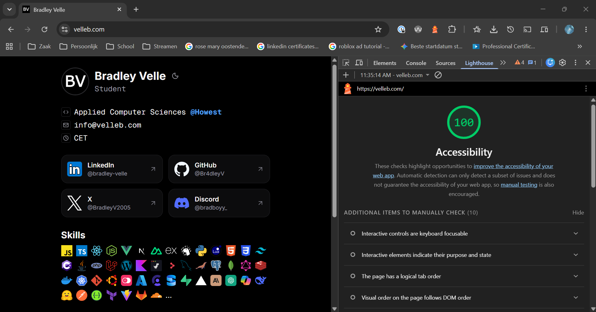

# A11Y Audit
Website: https://velleb.com

## Using automated tests
### Using WAVE
My website has a few things wrong, like 49 icons that are an empty link. I should add aria-label to them to fix it. I have no contrast errors, I have a redundant alt text which is unneeded. The rest is nice, but a score of 4/10 isn't nice. I then pushed an update that added those aria-label things and it worked.

### Using Lighthouse

All things passed, no issues left.

## Using manual tests (including mobile)
Using manual tests and using ARIA DevTools it shows my website nicely, no problems at all for me. Following the A11Y Project Checklist it is all correct, no skipped Heading levels and stuff.

## Reporting findings & learnings
So I found some issues with my own website, empty link errors. The rest was nicely done except a redundant alt tag. I fixed it, and now it is score 10 in WAVE. There are also no errors anymore in other tools like Lighthouse and stuff, and it shows nicely in Aria DevTools. Manual testing is necessary yes, but for me it was nicely done.