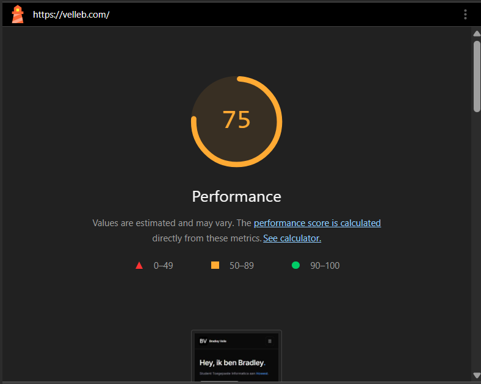
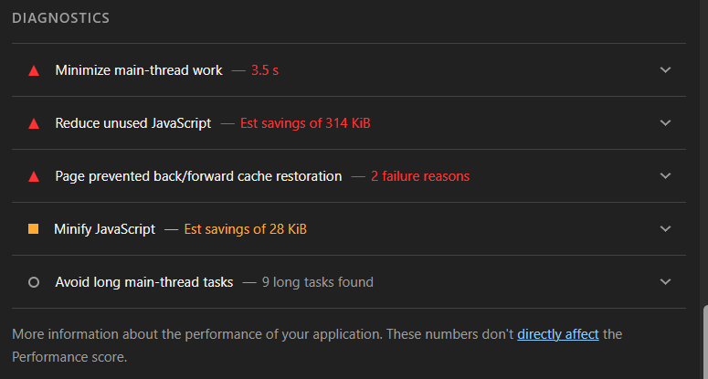
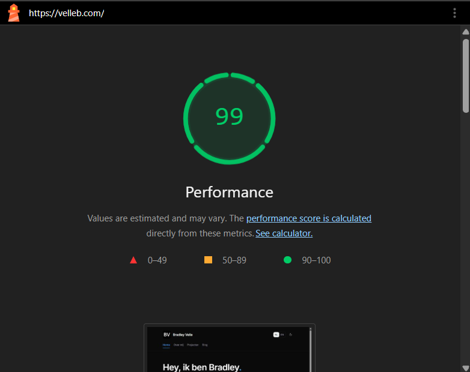
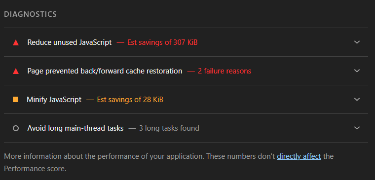
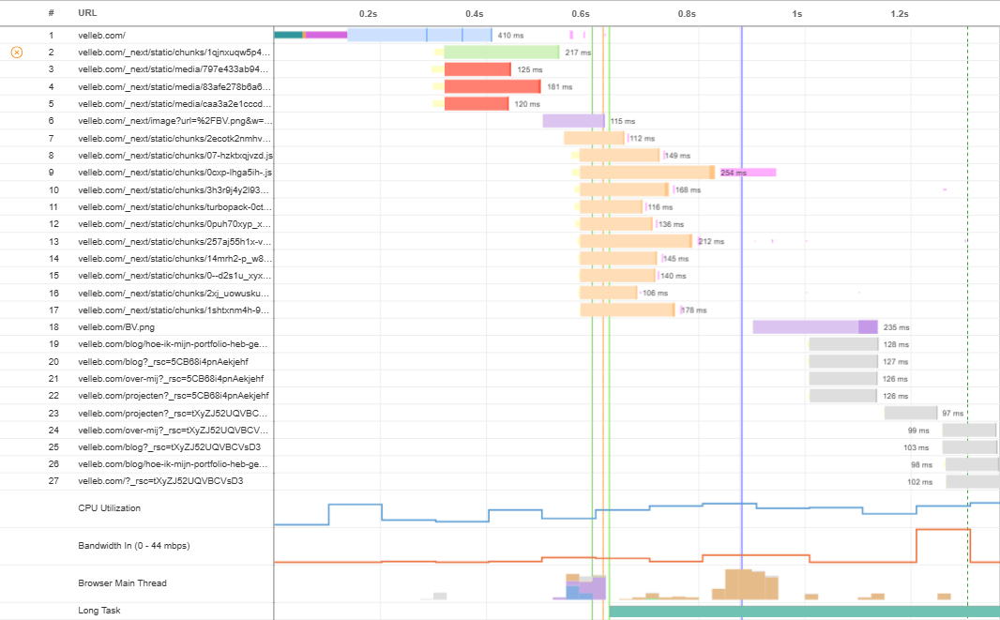

# Performance Audit existing website
Chosen website: https://velleb.com

## Lighthouse Performance test

### Mobile
Issues:
It needs smaller JS payloads, reduce unused JS and something saying "Page prevented back/forward cache restoration". These are the main issues that need to be fixed.

Positive results:
- Use efficient cache lifetimes:
    - This means that the website is using caching effectively, which helps improve load times for returning visitors.
- Layout shift culprits
    - This means that the website does not have significant layout shifts, which is good for user experience as it prevents unexpected movements of content while the page is loading.
- Document request latency
    - This means that the time it takes for the server to respond to requests is low, which is good for performance.
- Optimize DOM size
    - This means that the website has a manageable number of elements in the DOM, which helps improve performance as it reduces the amount of work the browser has to do to render the page.
- Duplicated JavaScript
    - This means that the website does not have duplicate JavaScript files, which is good for performance as it reduces the amount of code that needs to be downloaded and executed.
- Font display
    - This means that the website is using font-display, which helps improve performance by controlling how fonts are loaded and displayed.
- Forced reflow
    - This means that the website is not causing unnecessary reflows, which can be expensive in terms of performance as it forces the browser to recalculate the layout of the page.
- Improve image delivery
    - This means that the website is using techniques to optimize image delivery, such as using modern image formats and responsive images, which helps improve performance by reducing the amount of data that needs to be downloaded.
- Modern HTTP
    - This means that the website is using modern HTTP protocols, such as HTTP/2 or HTTP/3, which helps improve performance by allowing for faster and more efficient communication between the client and server.
- Optimize viewport for mobile
    - This means that the website is optimized for mobile devices, which helps improve performance by ensuring that the page is displayed correctly and efficiently on smaller screens.
- Minify CSS
    - This means that the website is using minified CSS, which helps improve performance by reducing the size of the CSS files that need to be downloaded.
- Reduce unused CSS
    - This means that the website is not including unnecessary CSS, which helps improve performance by reducing the amount of code that needs to be downloaded and executed.
- Avoids enormous network payloads --- Total size was 929 KiB
    - This means that the website is not sending large amounts of data over the network, which helps improve performance by reducing the time it takes to download resources.
- JavaScript execution time 1.1 s
    - This means that the time it takes for JavaScript to execute is relatively low, which helps improve performance by reducing the time it takes for the page to become interactive.
- Image elements have explicit width and height
    - This means that the website is specifying the width and height of image elements, which helps improve performance by preventing layout shifts and allowing the browser to allocate space for images before they are loaded.

### Desktop

It only needs reduced unused JS, and the "Page prevented back/forward cache restoration" issue. The rest of the issues are not present on desktop.
The performance is a lot better though.

## PageSpeed Insights
The mobile score is 95, way better than the lower one from my own findings. The rest is all the same.
There is no data available in Chrome User Experience Report.

## WebPageTest

### Reading the chart

The chart shows 27 requests over about 1.4 seconds. Each row is a file or some data the browser requests. Longer bars mean longer requests. The graphs at the bottom show network and browser activity. All times below are approximate.

### Issues and possible improvements

1. **The HTML loads first:** The first request takes about 410 ms, including connecting to the server. Other files are discovered as the HTML arrives. Faster HTML delivery would let them start sooner, although this time alone does not prove the server is slow.

2. **CSS delays the first display:** Request 2 takes about 217 ms and has an orange render-blocking icon. The browser waits for these styles before showing the styled page. Keep essential CSS small and load optional styles later.

3. **Many JavaScript files load together:** Requests 7-17 are 11 JavaScript files. They need downloading and processing. Remove unused code and load optional features when needed. The separate mobile Lighthouse test estimates 314 KiB of unused JavaScript.

4. **JavaScript keeps the browser busy:** The pink marks and orange main-thread activity show work after scripts download. This can delay rendering or clicks. Reduce startup work and break up long tasks. 

5. **Several fonts load early:** Requests 3-5 are font files, taking about 120-181 ms each. These add downloads before the page finishes displaying. Use fewer font styles or a system font, and keep a suitable fallback so text remains readable.

6. **An image loads late:** Request 18, `/BV.png`, starts around 910 ms and takes about 235 ms. If it is important visible content, load it earlier. Images further down the page can still load later.

7. **The same image may load twice:** Request 6 loads an optimized version of `/BV.png`, while request 18 loads the original. This is probably because of the Next.js Image component. 

8. **Other pages load in the background:** Requests 19-27 include `/blog`, `/over-mij` and `/projecten`. These are Next.js prefetches: downloading data before someone clicks a link. This speeds up navigation but uses extra data. Limit it for links visitors are unlikely to open.

9. **Some page paths appear repeatedly:** Several later requests use the same paths with different query values. 

10. **Some requests spend more time waiting than downloading:** Several bars have long pale sections and short dark sections. 

### What to fix first

Start with unused JavaScript, then check the image requests and background page loading. Repeat the test under the same conditions, including a slower mobile connection, to see whether the changes help.